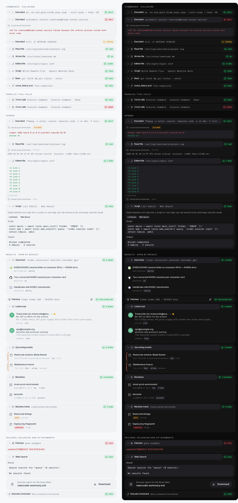
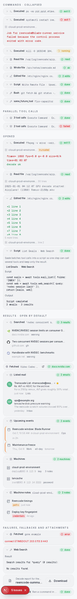

# Tool cards (chat transcript)



One component renders every tool call in the transcript. A card is **described,
never written**: a tool contributes a pure descriptor — a function from a tool
call to a `ToolCardModel` — and `ToolCard` renders any model. No tool name
appears in `tool-card.tsx`, and it has no per-tool branch.

Adding a tool means adding a descriptor. It never means adding a component.

## The pieces

| File                                    | Job                                                                                       |
| --------------------------------------- | ----------------------------------------------------------------------------------------- |
| `chat/tool-card.tsx`                    | The card: header, badge, expander, block renderer, row primitive. Knows no tool name.      |
| `chat/tool-card-model.ts`               | The contract — `ToolCardModel`, `ToolCardBlock`, `ToolRowModel`, `ToolDescriptor`.         |
| `chat/tool-status.ts`                   | Status vocabulary: `running` / `success` / `danger`, plus the label each one falls back to.|
| `chat/tool-descriptors/*.ts`            | One descriptor per tool family. Pure data — no JSX, no React, unit-testable without a DOM. |
| `chat/tool-cards.tsx`                   | The routing table: name / prefix → card. First match wins.                                 |
| `chat/tool-call-run.tsx`                | A turn's parallel calls, collapsed into one row.                                            |
| `lib/chat/tool-meta.ts`                 | Reads the `_saale*Meta` block a tool appends to its result.                                 |

## Rules

- **Status is one vocabulary.** `toolStatus(toolCall, label?, tone?)` derives the
  badge from the call's own state. A descriptor may supply a better *label*
  (`exit 0`, `2 edits`, `3 emails`) and, when the result knows better than the
  status, the tone — never a different vocabulary, never its own badge markup.
- **Collapsed by default.** A card shows one row until the user opens it.
  `defaultOpen` is for the cards whose rows *are* the answer (web, mail,
  calendar, machine and note lists) — and **always for a failure**: the reason
  is never behind a click.
- **The title never truncates; the detail always does.** The title is the card's
  identity. The detail (a command, query, path) carries `min-w-0 shrink-8
  truncate` and absorbs all the pressure. Safe because a title is short by
  construction — a descriptor names a tool, and the generic card caps the name of
  a tool it has never seen.
- **A card that cannot read its result falls back to the generic card.** A
  descriptor returns `null` and the call still renders, showing its raw arguments
  and result. A call must never vanish from the transcript.
- **Blocks are the extension point.** If a tool needs something the model cannot
  express, add a kind to `ToolCardBlock` and one case to the renderer — once, for
  every tool — rather than a per-tool component.
- **`show_file` is the exception.** It is an attachment (a preview and a
  download), not a report of a call, so it stays a bespoke component in
  `file-card.tsx`.
- **The share surface never sees these cards.** Public pages render
  `RedactedToolCall` only; `__tests__/share-redaction-coverage.test.ts` fails if a
  descriptor becomes reachable from a share page.

## Adding a tool

```ts
// chat/tool-descriptors/mail.ts
export const mailToolDescriptor: ToolDescriptor = {
  names: ["mail_list", "mail_search", "mail_read"],
  describe(toolCall) {
    const meta = extractToolMeta<MailMeta>(toolCall.result);
    if (!meta) return null; // → the generic card

    return {
      icon: Mail,
      title: "Listed mail",
      status: toolStatus(toolCall, plural(meta.count, "email", "emails")),
      defaultOpen: true,
      blocks: [{ kind: "rows", items: meta.emails.map(mailRow), empty: "No emails found" }],
    };
  },
};
```

Then register it in `tool-cards.tsx` (`ROUTES`) and add its name to `DESCRIBED`
in `__tests__/components/chat/tool-descriptors.test.ts` — that test fails when a
tool gains a descriptor without being declared, and when a described tool
silently loses its card.

## Screenshots

Both images are the real components: every block kind, each card collapsed and
opened, failures, the generic fallback, the attachment card and the redacted
share card, in light and dark.

|  |
| ------------------------------------------ |
| The same cards at 375px — titles intact, details truncating. |

Regenerating them needs a browser: the real transcript only exists behind a live
session and an SSE stream, so the cards were rendered from fixtures on a scratch
client route that imported `ToolCallView` / `ToolCallRun` directly, captured with
Playwright at 1240px and 375px in both themes, and the route was deleted
afterwards. Recreate it from `chat/tool-descriptors/` when the cards change — the
fixtures are a handful of `ToolCallData` objects wrapping the real `_saale*Meta`
blocks.
