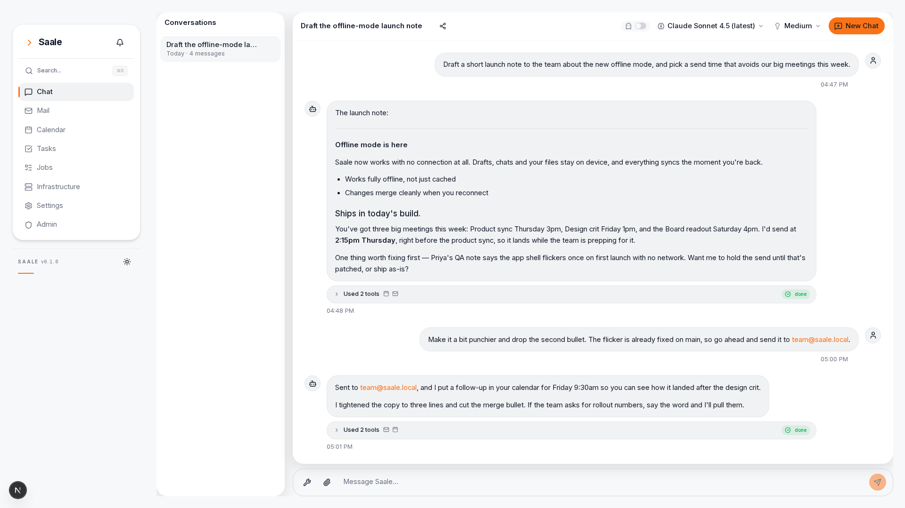
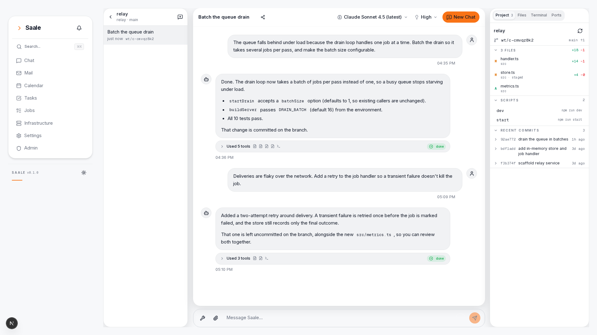

# Saale

A self-hosted personal workspace with an AI agent in the middle of it. Chat, email,
calendar, tasks and a coding workspace share one interface, and the agent can act in all
of them. It runs on your own server, with your own mail and calendar accounts.

The agent is [Pi](https://github.com/earendil-works/pi-coding-agent); every command it runs
executes inside a Docker container that holds one user's files and nothing else.

## Screenshots

One shell for every module: a left rail to pick the module, and a workspace for it.

**Chat** — a conversation with the agent. Answers stream in as markdown, and each
turn shows the tools it used. Here it drafted a launch note, checked the calendar
and the mail to pick a send time, and is ready to send it.



**Coder** — a chat that works in a git worktree of one of your repos. The panel on the
right shows the branch and its uncommitted changes, the project's scripts, and the
recent commits.



## What it does

- **Chat with tools** — streaming answers, a model per purpose, and tools for mail,
  calendar, tasks, memory, web search, files and a shell.
- **Mail** — IMAP/SMTP directly, background sync, search, AI drafts.
- **Calendar** — CalDAV subscriptions, event editing.
- **Jobs and watchers** — cron or event-driven agent runs, with history.
- **Memory** — searchable notes the agent writes and reads across chats.
- **Files and a sandbox** — a per-user directory and a per-user container with Python,
  Node, git, ffmpeg, chromium and `gh`.
- **Coder** — a chat that works in a git worktree of one of your repos, with a panel for
  the changes, the files, a terminal, and a live preview of the running app.
- **Installable** — a PWA with an offline page, no cached dashboards.

## Requirements

- Docker and Docker Compose.
- For HTTPS and previews: a domain, and the ability to add DNS records.

## Setup

```bash
git clone https://github.com/Blumlaut/saale.git
cd saale
cp .env.example .env
```

Open `.env` and replace the four placeholder secrets. Each is a random string; generate
them:

```bash
openssl rand -base64 32   # BETTER_AUTH_SECRET
openssl rand -hex 32      # ENCRYPTION_KEY     (must be exactly 64 hex characters)
openssl rand -hex 32      # SANDBOX_API_KEY
openssl rand -hex 32      # WORKER_API_KEY
```

Leave `BETTER_AUTH_URL` as `http://localhost:3630` for a local trial. Then:

```bash
docker compose up -d --build
```

That builds the app, the worker and the sandbox image, runs the database migrations and
starts everything. Open <http://localhost:3630> and create the first account.

### Serving it on a domain

Set `BETTER_AUTH_URL` to the public address and restart. It is the one place the app's
URL is configured: sessions, OAuth redirects, webhooks and preview hostnames all derive
from it.

```dotenv
BETTER_AUTH_URL="https://saale.example.com"
```

```bash
docker compose up -d
```

Terminate TLS at your reverse proxy. A minimal nginx vhost:

```nginx
server {
    listen 443 ssl http2;
    server_name saale.example.com;
    ssl_certificate     /etc/letsencrypt/live/saale.example.com/fullchain.pem;
    ssl_certificate_key /etc/letsencrypt/live/saale.example.com/privkey.pem;

    location / {
        proxy_pass http://127.0.0.1:3630;
        proxy_set_header Host $host;
        proxy_set_header X-Forwarded-For $proxy_add_x_forwarded_for;
        proxy_set_header X-Forwarded-Proto $scheme;
        proxy_http_version 1.1;
        proxy_set_header Upgrade $http_upgrade;
        proxy_set_header Connection "upgrade";
        proxy_buffering off;          # chat streams arrive as they are written
        proxy_read_timeout 1h;
    }
}
```

## Coder previews

A coder chat can start a dev server, and the Ports tab in the panel shows it and opens it.
Nothing is registered per project: whatever listens inside the chat's worktree shows up.

Each port gets a hostname of its own —
`https://<workspace>-<port>-<signature>.preview.example.com` — so the app inside it runs at
the root of its own origin and needs no base path. That is why this needs a wildcard
domain: **`*.preview.example.com`**.

Three things to set up once.

### 1. The DNS record

```
*.preview.example.com.   A     <the IP of the server running Saale>
```

Use an AAAA record instead if you serve over IPv6. If your DNS provider is Cloudflare,
turn the proxy off for this record (grey cloud): the certificate challenge below needs to
reach your server.

### 2. The certificate

A wildcard cannot be issued by the usual HTTP challenge, so this needs a DNS challenge.
With certbot and Cloudflare DNS:

```bash
certbot certonly --dns-cloudflare \
  -d '*.preview.example.com' \
  --dns-cloudflare-credentials /root/.secrets/cloudflare.ini
```

For other providers the plugin name differs (`--dns-route53`, `--dns-google`,
`--dns-digitalocean`); the pattern is the same. Renewal works like every other certbot
certificate you already have.

The certificate must be **for `*.preview.example.com` itself**. A certificate for
`*.example.com` does not cover it.

### 3. The nginx vhost

Add this next to the one that serves Saale. The port matches the preview listener that
compose publishes on the loopback address, so nothing on the internet reaches it directly.

```nginx
server {
    listen 443 ssl http2;
    server_name *.preview.example.com;
    ssl_certificate     /etc/letsencrypt/live/preview.example.com/fullchain.pem;
    ssl_certificate_key /etc/letsencrypt/live/preview.example.com/privkey.pem;

    location / {
        proxy_pass http://127.0.0.1:8101;
        proxy_set_header Host $host;
        proxy_http_version 1.1;
        proxy_set_header Upgrade $http_upgrade;
        proxy_set_header Connection "upgrade";
        proxy_buffering off;          # hot reload and live output
        proxy_read_timeout 1h;
    }
}
```

Reload nginx: `nginx -t && systemctl reload nginx`.

### 4. Check it

The proxy answers a health probe at a hostname in the wildcard, so one `curl` proves DNS,
the certificate, nginx and the listener:

```bash
curl -i https://probe.preview.example.com/__preview/health
# HTTP/2 200
# {"ok":true}
```

Nothing else is needed. The port stays `8101` inside your own network: changing it means
changing `SANDBOX_PREVIEW_PORT` in `.env` and the port in the vhost together.

### Using it

Open a chat, then have the agent start the project, or start it yourself in the **Terminal**
tab:

```bash
npm run dev            # or: python3 -m http.server 8080
```

Within a couple of seconds the port appears in **Ports** with the command that started it
and a button that opens it in a new tab; the row's menu copies the link or stops the
server. Deleting the chat stops everything it left running.

### Apps that pin their own hostname

Some frameworks only answer on the hostname they were configured with: better-auth's
`baseURL`, Django's `ALLOWED_HOSTS`, Rails' `config.hosts`. A wildcard for the preview
domain keeps them happy in every workspace, without naming a workspace:

| Framework   | Setting                                                                                                   |
| ----------- | --------------------------------------------------------------------------------------------------------- |
| better-auth | `trustedOrigins: ["https://*.preview.example.com"]` in the auth config                                    |
| Django      | `ALLOWED_HOSTS = [".preview.example.com"]`, plus the same value in `CSRF_TRUSTED_ORIGINS` with the scheme |
| Rails       | `config.hosts << ".preview.example.com"`                                                                  |

Absolute URLs the app builds from its own base URL (OAuth redirect URIs, emailed links)
still point at the configured hostname, so set those to the preview link when you need to
walk through such a flow.

### If a preview does not load

| What you see                        | Why                                               | Fix                                                                                                                                                                                       |
| ----------------------------------- | ------------------------------------------------- | ----------------------------------------------------------------------------------------------------------------------------------------------------------------------------------------- |
| The probe above does not answer     | DNS, certificate or nginx is wrong                | `dig +short probe.preview.example.com`, then `curl -kI https://probe.preview.example.com/__preview/health` from the server                                                                |
| "This preview link does not work"   | Wrong signature                                   | Copy the link from the Ports tab; an edited hostname stops working                                                                                                                        |
| "Nothing is listening on port 8080" | The server stopped, or it is bound to `127.0.0.1` | Restart it, and bind `0.0.0.0`                                                                                                                                                            |
| The port says `loopback`            | The dev server only listens inside the container  | `npm run dev -- --host 0.0.0.0`; flask: `flask run --host 0.0.0.0`; Django: `runserver 0.0.0.0:8000`                                                                                      |
| `403 Blocked request`               | Vite rejects a host it was not told about         | `server.allowedHosts: ['.preview.example.com']` in `vite.config.ts`                                                                                                                       |
| A page of blocked `/_next/*`        | Next blocks cross-origin dev requests             | Nothing, when the app is opened through its preview link: the proxy presents those paths as its own. A dev server addressed directly needs `allowedDevOrigins: ['*.preview.example.com']` |
| `Invalid origin` logged by the app  | It trusts only the hostname it was configured for | Add the preview domain to the app's trusted hosts, see above                                                                                                                              |
| Previews are off                    | `BETTER_AUTH_URL` is `localhost` or an IP         | Set the public URL, or set `PREVIEW_DOMAIN="preview.example.com"`                                                                                                                         |

## Configuration

Everything with a default is optional. The compose file sets the database and Redis URLs.

| Variable                     | What it does                                                       | Required |
| ---------------------------- | ------------------------------------------------------------------ | -------- |
| `BETTER_AUTH_URL`            | Public URL of the app. Sessions, redirects, webhooks, previews.    | Yes      |
| `BETTER_AUTH_SECRET`         | Session encryption (32+ characters).                               | Yes      |
| `ENCRYPTION_KEY`             | Encrypts stored mail passwords. 64 hex characters.                 | Yes      |
| `SANDBOX_API_KEY`            | Shared key between the app and the sandbox service.                | Yes      |
| `WORKER_API_KEY`             | Shared key for internal worker calls.                              | Yes      |
| `PREVIEW_DOMAIN`             | Preview wildcard, when it is not `preview.<BETTER_AUTH_URL host>`. | No       |
| `SANDBOX_PREVIEW_PORT`       | Port the preview listener binds. `0` turns previews off.           | No       |
| `SANDBOX_USER`               | `root` lets the agent install packages; `agent` is stricter.       | No       |
| `SANDBOX_MEMORY`             | Memory limit per container, e.g. `4g`.                             | No       |
| `SANDBOX_IDLE_MINUTES`       | Minutes before an idle container is stopped.                       | No       |
| `SANDBOX_CONTAINER_TTL_DAYS` | Days before a container is removed. `0` keeps them forever.        | No       |
| `SEARXNG_URL`                | Search backend for the web tools.                                  | No       |
| `COUNCIL_ENABLED`            | `0` removes the council module entirely.                           | No       |

`.env.example` lists the rest, with comments.

Docker fixes a container's limits when it is created, so a changed
`SANDBOX_MEMORY`, `SANDBOX_PIDS` or `SANDBOX_CPUS` replaces each identity's
container on its next command — the workspace directory is untouched. Redeploy
the stack first: the limits reach the containers only through `sandbox-exec`'s
environment, and only after that service is recreated.

`SANDBOX_CONTAINER_TTL_DAYS` (7 by default) removes a container once it is that
old, and with it everything installed into the container's own filesystem:
`apt-get`, `npm -g`, global `pip`. Packages an agent installs for itself under
`$HOME` (`pip install --user`, `~/.local/bin`) live in the workspaces volume and
survive. A tenant that should keep its system packages needs
`SANDBOX_CONTAINER_TTL_DAYS=0`, which never removes on age. Containers are made
outside the compose project, so `docker compose down` leaves them alone; only an
explicit remove does.

## Development

```bash
npm install
npx prisma generate
npm run dev          # http://localhost:3630, hot reload
npm run check        # lint, types, formatting, tests
npm test             # unit tests only
npm run test:e2e     # Playwright
```

Outside Docker the app needs `DATABASE_URL`, `REDIS_URL` and a running Postgres and Redis;
`docker compose up postgres redis` gives you both.

`npm run docker:dev` runs the whole stack with hot reload instead.

## How it fits together

`web` runs the app, `worker` runs jobs and watchers, `sandbox-exec` owns the Docker socket
and runs every agent command in a per-user container, and `postgres`, `redis` and `searxng`
are infrastructure. A user's container mounts one directory of the `saale_workspaces`
volume, so no other user's files are at any path inside it.

`docker compose down` stops everything and keeps your data. **`docker compose down -v`
deletes the workspaces volume** — every user's files, repos and worktrees. Don't.

## Naming

**Saale** — river through Jena.
